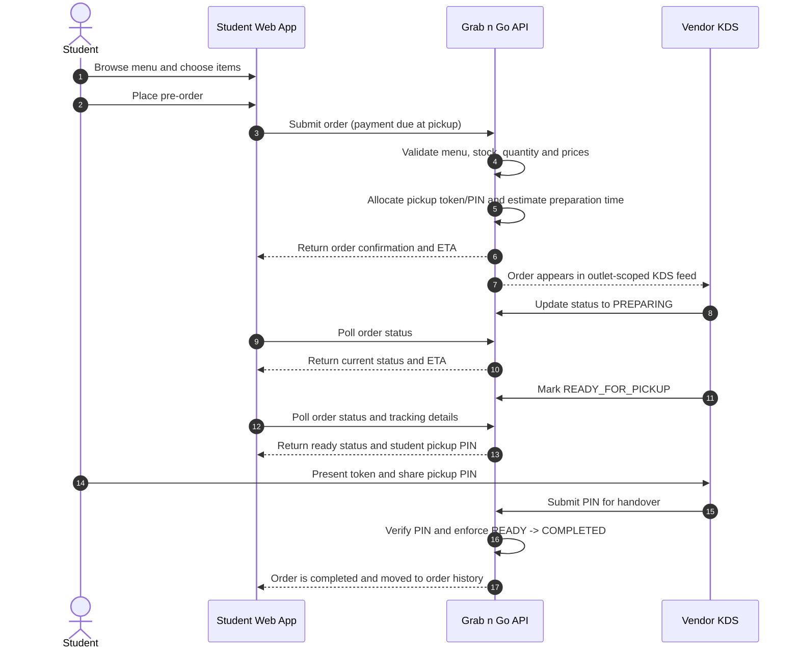

# Grab n Go — Smart Food Court Solution (IIT Patna)

> **"Order Smart. Track Live. Save Time."**  
> A dedicated food pre-ordering and live queue tracking platform tailored to eliminate campus dining delays and counter chaos at IIT Patna.

---

## 📌 1. Project Background & Business Insights

Based on on-ground research and student interviews conducted at **IIT Patna Food Court & Angeethi Café**:
* **The Core Problem:** Ordering food during lunch and evening rush hours is manual, unpredictable, and takes away 20–30 minutes of short academic breaks. Students often risk being late to class or skip meals altogether.
* **The Confusion Factor:** High background noise, manual cash/UPI collection, and verbal communication cause frequent order mix-ups, missing items, and zero queue transparency.
* **The Solution:** **Grab n Go** enables students to inspect real-time rush across outlets, place advance pre-orders, receive a unique pickup token (e.g., `#A-104`), track preparation live, and walk up directly to an express counter to grab their meal when notified.

---

## 🍽️ 2. Integrated Campus Outlets & Menu Data

The platform comes pre-configured with campus outlets, featuring a full digital menu model for **Arya Services** (contact: `9835493001` / `9572544000`) across all 12 categories:
1. **Mushrooms** (Mushroom Butter Masala, Handi, Kadhai, Dehati, etc.)
2. **Tandoor** (Tandoori Roti, Naan, Paneer Tikka, Chicken Tikka, Tandoori Chicken Half/Full)
3. **Chicken and Egg** (Chicken Butter Masala, Dehati, Handi, Egg Curry, etc.)
4. **Burgers & Pizzas** (Veg Burger, Paneer Burger, Grilled Sandwiches, Veg/Non-Veg Pizzas)
5. **Rotis & Rolls** (Tawa Rotis, Egg/Chicken/Paneer/Veg Rolls, Pokoras)
6. **Noodles & Maggi** (Veg/Egg/Paneer/Non-Veg Noodles, Classic/Veg/Egg Maggi)
7. **Chilly Dishes** (Paneer Chilly, Manchurian, Garlic Chicken, Chicken 65, Baby Corn)
8. **Sweets** (Kuladh Kheer, Gulab Jamun, Rasmalai, Rasgulla, Launglatta)
9. **Paneer & Veg Sabzi** (Paneer Butter Masala, Kadhai, Bhurji, Malai Kofta, Aloo Bhujiya)
10. **Dal** (Dal Plain, Dal Fry, Dal Makhani, Dal Tarka)
11. **Rice & Biryani** (Jeera Rice, Fried Rice, Veg/Egg/Chicken/Mutton Biryani)
12. **Paratha** (Aloo, Paneer, Mix, Sattu, Egg, Methi Parathas)

*Raw digital seed file:* [`data/outlets/arya_services_menu.json`](data/outlets/arya_services_menu.json)

---

## 📁 3. Project Directory Structure

```text
Grab n Go/
├── index.html                     # Student ordering and tracking UI
├── js/
│   ├── consumer_app.js            # Student auth, cart, orders and tracking
│   └── data.js                    # Public campus/menu presentation data
├── vendor/
│   ├── index.html                 # Vendor KDS sign-in and kitchen board
│   └── vendor.js                  # Vendor auth, order states, stock and rush mode
├── admin/
│   ├── index.html                 # Administrator sign-in and dashboard
│   └── admin.js                   # Provisioned admin auth and analytics
├── css/style.css                  # Shared styling
├── apps/backend/src/
│   ├── api_router.js              # Role-protected REST API
│   ├── modules/auth/              # Email OTP, password accounts and JWTs
│   ├── modules/orders/            # Pricing, order lifecycle and PIN handover
│   ├── modules/tokens/            # Pickup token/PIN generation and verification
│   ├── modules/menu/              # Menu and outlet-scoped stock management
│   ├── modules/outlets/           # Outlet and rush configuration
│   ├── database/prisma.js        # Shared Prisma Client
│   └── database/legacy_json_store.js # One-time JSON import source only
├── data/outlets/                  # Seed menu data
├── scripts/create-account.js      # Secure vendor/admin account provisioning
├── AUTH_SETUP.md                  # SMTP and account setup instructions
├── INTEGRATION_NOTES.md           # Current architecture and implementation status
├── .env.example                   # Required configuration template
├── server.js                      # Static-file allowlist and API host
└── test_backend_api.js            # End-to-end API integration tests
```
---

## 🔄 4. Order Lifecycle & Queue Mechanics



---

## 🚀 5. Run and configure

1. Use Node.js 18 or newer.
2. Run `npm install`.
3. Copy `.env.example` to `.env`.
4. Set a unique `JWT_SECRET` and configure an authorised SMTP relay.
5. Provision at least one vendor account and one administrator account using the commands in `AUTH_SETUP.md`.
6. Run `npm run check`, `npm test`, then `npm start`.

Only Arya Services currently has a digital menu seed. Other outlet ordering is disabled until their real menu data is added.

## Current integration status

See [INTEGRATION_NOTES.md](INTEGRATION_NOTES.md) for the current API and database architecture. Runtime persistence uses PostgreSQL through Prisma. Student sign-in uses IITP institutional email OTP (SMTP configuration required); vendor and admin access use provisioned password accounts. This verifies mailbox ownership but is not official IITP SSO. Online payments and Student Pass activation remain disabled.


## Authentication setup

See [AUTH_SETUP.md](AUTH_SETUP.md) for student email OTP configuration, vendor/admin account provisioning, required environment variables and identity limitations.


## Canonical web entry points

The root server serves the maintained applications:

- Student ordering: `/`
- Vendor kitchen display: `/vendor`
- Campus administration: `/admin`
- Backend API: `/api/v1`

Duplicate legacy front-end copies under `apps/` were removed to avoid stale authentication code. `apps/backend/` remains the single backend implementation.

## PostgreSQL / Prisma production setup

The backend now uses PostgreSQL through Prisma for runtime persistence. Follow [PRISMA_MIGRATION.md](PRISMA_MIGRATION.md) for local setup, one-time catalog/legacy import, account provisioning and Render deployment. Do not run the legacy JSON importer on every deployment.
